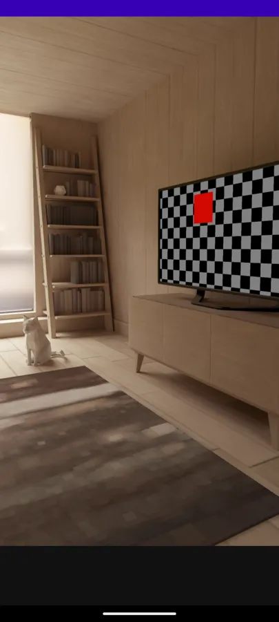

# QR Code Scanner (Jetpack Compose)

**An Android app that reads QR codes from the back camera with CameraX and ZXing, and shows the decoded text under the preview.**



*Emulator screenshot (virtual camera feed). No QR code was in view, so no text is shown.*

## What it does

- Asks for camera permission when the app starts.
- Shows a live back-camera preview (CameraX `PreviewView` inside Compose).
- Analyses each frame on the main thread with an `ImageAnalysis` analyzer and decodes **QR codes only** (`BarcodeFormat.QR_CODE`).
- Displays the last decoded text in bold below the preview.

## Tech stack

Kotlin · Jetpack Compose (Material 2 components) · CameraX 1.4.0 (`camera2`, `lifecycle`, `view`) · ZXing core 3.5.3 · AGP 8.3.2, Gradle 8.9 · minSdk 26, targetSdk 34

## How it is built

- `MainActivity.kt` owns the Compose UI: permission state, the camera provider, and the result text.
- `QrCodeAnalyzer.kt` is a CameraX `ImageAnalysis.Analyzer`. It turns the Y plane of each YUV frame into a `PlanarYUVLuminanceSource`, runs a ZXing `MultiFormatReader` restricted to QR codes, and passes the text to a callback. Frames are dropped with `STRATEGY_KEEP_ONLY_LATEST`.

## Limitations

- Only QR codes are decoded.
- The decoded text is shown as is. Nothing is parsed, opened or saved.
- The project has no UI tests yet (only the default example tests).

## Getting started

Requirements: Android Studio, JDK 17, a device or emulator with API 26+ and a camera.

```bash
git clone https://github.com/Goudurixx/QrCodeScannerCompose.git
cd QrCodeScannerCompose
./gradlew assembleDebug
```

Open the project in Android Studio, run the `app` configuration, and grant the camera permission.
